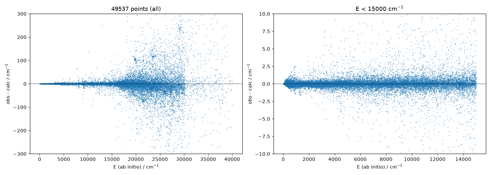
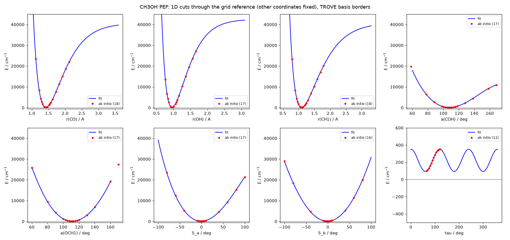

# CH₃OH PES Refit and TROVE J = 0–3 with Unfrozen Bends and a Production-Type Basis

**Author:** Sergey Yurchenko · **Dates:** 24–25 October 2026
**Follows:** the CH₃OH torsional-rovibrational KEO and C₃ᵥ(M) symmetry work in TROVE (TROVE commits 70e668d and 1ecc400)
**Working directory:** `~/ExoMol/CH3OH/pes_refit/` · **Deliverables:** `~/ExoMol/CH3OH/pes_refit/final/`

## Executive Summary

This report covers the work after the C₃ᵥ(M) symmetry fixes in TROVE. It has three parts.

1. **PES refit.** I built a new fitting code using the CH₃Br program as a prototype. With it, I refitted the CH₃OH potential energy surface (PES) to all 49,537 CCSD(T)/CBS energies from the ExoMol repository. The coordinate definitions were checked against TROVE and the working potential.
2. **TROVE with unfrozen bends.** I ran J = 0–3 with the bends active, for a first test of the bending and torsional basis.
3. **Production-type basis.** I ran a basis with all vibrational modes v ≤ 4, 9 torsional functions and polyad P ≤ 8. It runs through a disk-efficient, sliced J = 0-contraction workflow.

Every TROVE calculation in this report, J = 0 to 3 in all bases, finished with **no symmetry errors**.

The new PES reproduces the ab initio data with an rms of 0.19, 0.36, 1.18 and 2.64 cm⁻¹ below 2000, 5000, 10,000 and 15,000 cm⁻¹. The previous fit gave 1.33, 5.56, 22.3 and 45.6 cm⁻¹ on the same points. Constrained searches found no holes where the separable energy is below 40,000 cm⁻¹.

The audit also found a real inconsistency in the earlier working TROVE input. Its EQUILIBRIUM/SPECPARAM blocks (Morse exponents and reference geometry) did not match the parameters behind the potential coefficients. As a result, the CH-stretch levels of the earlier J = 0–5 runs were about 150 cm⁻¹ too low. The symmetry conclusions of those runs are unaffected.

With the production-type basis (PB8E10, 40,214 functions), most fundamentals agree with experiment to about 5–25 cm⁻¹:

| | Calculated (cm⁻¹) | Experiment (cm⁻¹) |
| --- | --: | --: |
| Ground-state A–E tunnelling splitting | 9.30 | 9.12 |
| Torsional v_t = 1 (E / A) | 210.3 / 299.9 | ≈ 209 / 294 |
| CO stretch | 1038.9 | 1033 |
| CH₃ umbrella | 1459.8 | 1455 |
| OH stretch | 3701.7 | 3681 |

The K = 0 A rotational ladder for J = 1–3 matches experiment to **0.1 %**. The remaining errors now come mainly from the ab initio PES rather than the basis, which makes the model ready for refinement against experiment.

> **Note:** The band origins quoted in the earlier summary document (for example the CH stretch at 2761.7 cm⁻¹) were computed with the inconsistent EQUILIBRIUM/SPECPARAM. With consistent parameters, the same PES gives about 2911.7 cm⁻¹ in that basis (see Section 2.4).

## 1. Part I — PES Refit to 49,537 CBS Energies

### 1.1 Fitting code and coordinate consistency

The CH₃Br fitting program (`CH3Br_fitpes.f90`) and the original CH₃OH program (`CH3OH_v10_theta12_14-MAPLESym-13-09.f90`) both descend from the same C₂H₆ fitting code. The CH₃Br version is the better architectural starting point.

- **What carries over from CH₃Br:** standard Fortran, dynamic arrays, and one-pass evaluation of the basis.
- **What does not carry over:** its X-R-BETA-SYM coordinates. Their second E coordinate has the opposite sign, the C₃ matrices are transposed, and there is no OH stretch, COH bend or torsion.

The new program `CH3OH_fitpes.f90` therefore keeps the CH₃Br structure and uses the CH₃OH coordinates and C₃ᵥ(M) operations. It reads the input format of `CH3OH_v10`. It adds BLAS-3 normal equations with a Cholesky or eigen-cutoff solver and ridge regularisation, Partridge–Schwenke plus Watson robust weights, fixed-weight pseudo-points, and output of the TROVE POTEN and EQUILIBRIUM/SPECPARAM blocks. A full robust fit of 49.5k points with 4.8k terms takes about 30 s.

Numerical tests show that the `CH3OH_v10` functional form, the H2↔H3 relabelling of the Molpro z-matrix, the dihedral conventions, the S\_a/S\_b/τ definitions and the C₃ᵥ(M) operations are identical to TROVE `R-ALPHA132-THETA-S-TAU` / `C3v(M)-2` and to `AB3CD.nb`.

The raw τ formula of `CH3OH_v10` only works inside the dihedral window of the grid. The new code uses the chart-consistent definition τ = θ₁ + (√2/3)·S\_b (mod 2π). It gives the same values on the grid and stays invariant under proton relabelling.

The exact KEO in `kinetic.chk` uses constant coefficients times absolute-coordinate basic functions. It therefore does not depend on EQUILIBRIUM and was reused unchanged.

The audit found one genuine inconsistency, in the working TROVE input. TROVE builds its Morse and displacement potential coordinates from EQUILIBRIUM and SPECPARAM, but these blocks did not match the fit that produced the coefficients:

| | TROVE input (old) | Fit (00-2D-refitMAPLE-15-09.res) |
| --- | --: | --: |
| rₑ(CO) / rₑ(OH) / rₑ(CH), Å | 1.42194259 / 0.95640043 / 1.09066795 | 1.42167424 / 0.95631449 / 1.09061196 |
| αₑ(COH) / αₑ(OCH), deg | 108.09748505 / 110.28648298 | 108.10245297 / 110.28972802 |
| β(CO) / β(OH) / β(CH), Å⁻¹ | 2.16893551 / 2.57276067 / **1.78266276** | 2.17023887 / 2.55392176 / **1.85744195** |

The PES that TROVE actually evaluated therefore differed from the fitted surface by an rms of 103 cm⁻¹ below 5000 cm⁻¹. Most of this comes from β(CH), which was 4 % too small, and β(OH), which was 0.7 % too large. The new pipeline writes EQUILIBRIUM and SPECPARAM directly from the fitted parameters.

### 1.2 Fit set-up and quality

The data set `CH3OH-CBS.energies` contains 49,537 points up to 40,000 cm⁻¹ above the minimum. Most points beyond the original 14,608-point grid are simultaneous displacements of 3–6 coordinate groups, which the old two-mode-coupling expansion could not describe.

- **Expansion:** 4,839 symmetry-adapted terms: one coordinate group up to 8th order, two groups up to 6th, three up to 5th and four up to 4th, plus Fourier couplings and pure torsion cos 3nτ with n ≤ 6. The term set was chosen with a 90/10 train/test split.
- **Non-linear parameters:** the reference geometry and Morse exponents were kept at the previous values. The rms is insensitive to ±10 % changes in the exponents.
- **Weights:** Partridge–Schwenke weights with a floor of 0.003, Watson robust re-weighting, and a ridge of 10⁻⁷. The floor proved essential: without it, the robust fit effectively discarded the 20,000–40,000 cm⁻¹ points and developed deep holes.
- **Hole patches:** 35 hole geometries found in two rounds of constrained searches were added as pseudo-points at 0.9·V\_sep with weight 0.005.

The table compares the new and old fits on all 49,537 points, together with the test-set rms of the 90/10 validation.

| E\_max (cm⁻¹) | N points | rms new | max abs dev new | rms old fit | test-set rms |
| --: | --: | --: | --: | --: | --: |
| 2,000 | 15,319 | **0.19** | 3.3 | 1.33 | 0.19 |
| 5,000 | 25,059 | **0.36** | 18.7 | 5.56 | 0.40 |
| 10,000 | 31,774 | **1.18** | 65.9 | 22.29 | 1.90 |
| 15,000 | 37,386 | **2.64** | 248 | 45.58 | 7.7 |
| 20,000 | 42,123 | **9.6** | 478 | 74.06 | 14.3 |
| all | 49,537 | 51.4 | 3,041 | 154.9 | — |

The fit is at the 1 cm⁻¹ level below 10,000 cm⁻¹. Above 15,000 cm⁻¹ the test-set rms shows that the 49.5k grid is still sparse for a 12-dimensional surface. Further improvement there needs more ab initio points rather than more terms.

The equilibrium of the fitted PES lies 36.7 cm⁻¹ below the lowest grid point, at the staggered τ = 60° Cs structure: r(CO) = 1.41928 Å, r(OH) = 0.95783 Å, r(CH, in-plane/out-of-plane) = 1.08718/1.09275 Å, and ∠COH = 108.245°. The relaxed torsional barrier is 349 cm⁻¹.

### 1.3 Behaviour at large displacements

The 1D cuts over the TROVE basis borders each show a single minimum, with physical dissociation plateaus (≈ 39,800 cm⁻¹ for CO, 42,100 for OH and 39,400 for CH) and steep repulsive walls. The lowest value on any of the 66 2D cuts is +13.4 cm⁻¹.

For holes, I sampled 10⁶ random geometries and ran 6,000 constrained descents, each restricted to the shells V\_sep < 30,000 and V\_sep < 40,000 cm⁻¹. No holes were found; the lowest point reached is the equilibrium. As for any polynomial, the PES is unbounded only in extreme corners far outside the region sampled by the TROVE basis.

### 1.4 TROVE check of the new PES (frozen-bend test basis)

An exact `potential.chk` (23,616 terms, conversion error 3×10⁻¹⁰ cm⁻¹) was generated with consistent EQUILIBRIUM/SPECPARAM. TROVE J = 0–3 in the earlier test basis (stretches v ≤ 2, bends frozen, 3 torsional functions) ran without symmetry errors.

To isolate the effect of the inconsistency, the old PES was re-run with its own fitted parameters ("old, consistent"):

| Band | old, original input | old, consistent | new PES |
| --- | --: | --: | --: |
| CH stretch (A1) | 2761.7 | 2911.7 | 2913.8 |
| CH stretch (E) | 2812.6 | 2963.1 | 2967.0 |
| OH stretch (A1) | 3720.8 | 3694.8 | 3696.5 |

Near equilibrium, the new PES agrees with the consistently evaluated old PES to about 3.5 cm⁻¹ rms. The large shifts in the original runs came only from the parameter inconsistency.

## 2. Part II — TROVE J = 0–3 with the Bends Unfrozen

The requested run (P6) unfreezes the COH bend and the three OCH angles with v ≤ 2, the same as the stretches.

- **Polyad weights:** CO 1, OH 2, CH 2, COH 1, OCH 1, S 1, torsion 0.1. The torsion never enters the polyad, so A and E torsional components are always kept together.
- **Basis size:** the polyad limit P ≤ 6 keeps the J = 0 basis at 6,333 functions.

In the earlier frozen-bend runs the OCH/COH coordinates only ever had v = 0, so their transformation under C₃ᵥ(M) was never really exercised. This run tests it.

| Basis | J | A1 | A2 | E | Symmetry-error lines |
| --- | :-: | --: | --: | --: | :-: |
| P6 (product basis) | 0 | 1160 | 951 | 2111 | **0** |
| P6 | 1 | 3062 | 3271 | 6333 | **0** |
| P6 | 2 | 5382 | 5173 | 10555 | **0** |
| P6 | 3 | 7284 | 7493 | 14777 | **0** |

The symmetrisation of the bend class and its products with the stretch, S and torsional classes holds up to J = 3. The physics of this test basis brought three lessons.

- **Rotational structure.** Unfreezing the bends improves the rotational structure: the J = 1, K = 0 A level moves from 1.941 to 1.693 cm⁻¹ (exp. 1.6135).
- **Bend basis.** v ≤ 2 for the bends is not enough: the CH₃ umbrella comes out at 1583 cm⁻¹. With v ≤ 4 (run P6B4) it drops to 1461 cm⁻¹ (exp. 1455), and all bending fundamentals move to within 5–35 cm⁻¹ of experiment. The KEO and PES are fine; only the basis was too small.
- **Torsional basis.** The 3-function torsional basis of the original test input (only the A1 + E ground triplet) becomes the limitation once the bends couple to the torsion.
  - The A–E splitting grows to 18.4 cm⁻¹, against 9.12 experimentally, and the E-level pattern is wrong.
  - With 9 torsional functions (P6T8) the splitting is 9.51 cm⁻¹ and the torsional fundamentals appear at 207.5 cm⁻¹ (E) and 297.5 cm⁻¹ (A2).

## 3. Part III — Production-Type Basis (v ≤ 4, 9 Torsional Functions, P ≤ 8), J = 0–3

All three bases keep v ≤ 4 in every vibrational class and use the polyad weights CO 1, OH 2, CH 2, COH 1, OCH 1, S 1, torsion 0.34. With the weight 0.34, each torsional triplet counts as one polyad unit, and the A and E components of a triplet always carry the same polyad. The main basis, PB8E10, uses 9 torsional functions and P ≤ 8.

- **Why the energy cut.** The full P ≤ 8 basis has 74,265 functions. The J = 0 step would need about 90 GB of RAM, which was not available next to the other jobs on this machine. PB8E10 therefore adds a zero-order energy cut of 10,000 cm⁻¹, which gives 40,214 functions.
- **Convergence runs.** PB6 (P ≤ 6, 15,093 functions) and PB6T11 (12 torsional functions) check the polyad and torsional convergence.

| | PB6 | PB6T11 | **PB8E10** | PB8 (full, not run) |
| --- | --- | --- | --- | --- |
| Torsional functions | 9 | 12 | 9 | 9 |
| P\_max / zero-order cut | 6 / none | 6 / none | **8 / 10,000 cm⁻¹** | 8 / none |
| J = 0 functions | 15,093 | 15,549 | **40,214** | 74,265 |
| J = 0 blocks A1 / A2 / E | 2639 / 2392 / 5031 | 2697 / 2486 / 5183 | 6882 / 6512 / 13410 | 12741 / 12014 / 24755 |

J > 0 uses TROVE's J = 0 contraction: J = 0 eigenstates up to 6000 cm⁻¹ above the zero-point energy form the vibrational basis. Normally TROVE writes all 12 rotational and Coriolis slices (N × N each) before the conversion, which needs too much disk for these basis sizes. Each slice is therefore computed (`matelem save split s s`), converted to the J = 0 basis (`matelem convert split s s`) and deleted before the next one. Peak disk drops from 13·N²·8 bytes to about 2·N²·8 bytes. Tested on the P6 basis with the complete J = 0 basis kept, this sliced route reproduces all 12,666 product-basis J = 1 levels to 10⁻⁶ cm⁻¹.

| Basis | J | A1 | A2 | E | Symmetry-error lines |
| --- | :-: | --: | --: | --: | :-: |
| PB6 | 0 / 1 / 2 / 3 | 2639 / 1381 / 2399 / 3271 | 2392 / 1454 / 2326 / 3344 | 5031 / 2841 / 4735 / 6629 | **0** |
| PB6T11 | 0 | 2697 | 2486 | 5183 | **0** |
| **PB8E10** | 0 / 1 / 2 / 3 | 6882 / 1715 / 2957 / 4051 | 6512 / 1789 / 2883 / 4125 | 13410 / 3510 / 5850 / 8190 | **0** |

The J > 0 E blocks are exactly (2J + 1) times the number of E-type J = 0 levels kept: 947 for PB6 and 1170 for PB8E10.

The J = 0 band origins below are compared with approximate experimental values (Shimanouchi/NIST fundamentals and the K = 0 torsional levels of methanol). Assignments follow the largest basis contribution and are tentative in the strongly mixed CH-stretch and OH-bend regions.

| Band | Exp. | Γ | PB6 | PB6T11 | **PB8E10** | PB8E10 − exp. |
| --- | --: | :-: | --: | --: | --: | --: |
| v\_t = 0 tunnelling | 9.12 | E | 9.39 | 9.22 | **9.30** | +0.2 |
| v\_t = 1 | ≈ 209 | E | 212.72 | 211.13 | **210.33** | ≈ +1 |
| v\_t = 1 | ≈ 294 | A2 | 302.75 | 297.84 | **299.86** | ≈ +6 |
| v\_t = 2 | ≈ 353 | A1 | 367.87 | 364.23 | **358.68** | ≈ +6 |
| ν8 CO stretch | 1033 | A1 | 1043.21 | 1043.25 | **1038.87** | +6 |
| ν7 CH₃ rock a′ | 1060 | A1 | 1082.51 | 1082.47 | **1079.27** | +19 |
| ν11 CH₃ rock a″ | 1165 | A2 | 1170.60 | 1171.44 | **1168.30** | +3 |
| ν6 OH bend | 1345 | A1 | 1333.43 | 1333.17 | **1326.13** (mixed) | −19 |
| ν5 CH₃ umbrella | 1455 | A1 | 1461.44 | 1461.48 | **1459.79** | +5 |
| ν10 CH₃ deformation a″ | 1477 | A2 | 1484.95 | 1484.85 | **1482.61** | +6 |
| ν4 CH₃ deformation a′ | 1477 | A1 | 1492.97 | 1492.90 | **1490.74** | +14 |
| ν3 CH₃ sym. stretch | 2844 | A1 | 2876.36 | 2874.57 | **2866.84** | +23 |
| ν9 CH₃ asym. stretch a″ | 2960 | A2 | 2943.45 | 2943.31 | **2937.57** | −22 |
| ν2 CH₃ asym. stretch a′ | 3000 | A1 | 3027.25 | 3027.34 | **3019.33** | +19 |
| ν1 OH stretch | 3681 | A1 | 3702.47 | 3702.47 | **3701.65** | +21 |

**Polyad convergence.** Going from PB6 to PB8E10 changes the bending fundamentals by only 2–5 cm⁻¹ (7 cm⁻¹ for the mixed OH bend), the CH stretches by 6–10 cm⁻¹ and the OH stretch by 1 cm⁻¹.

**Torsional convergence.** Going from 9 to 12 torsional functions changes the vibrational fundamentals by at most 2 cm⁻¹, the ground-state splitting by 0.17 cm⁻¹ and the v\_t = 1 levels by 1.6–4.9 cm⁻¹. The v\_t = 2 E level, however, moves by 40 cm⁻¹. A torsional range of 0–8 is therefore adequate for v\_t ≤ 1, and v\_t = 2 needs a range of at least 0–11.

The table below compares the lowest K = 0 A level and the lowest E level for J = 0–3 with experiment. The experimental A levels come from the 1₀–0₀, 2₀–1₀ and 3₀–2₀ A⁺ lines (48.372, 96.741 and 145.103 GHz).

| J | K = 0 A: PB6 | **PB8E10** | Exp. | Lowest E: PB6 | **PB8E10** | Exp. |
| :-: | --: | --: | --: | --: | --: | --: |
| 0 | 0 | 0 | 0 | 9.392 | **9.300** | 9.12 (0₀ E) |
| 1 | 1.6169 | **1.6151** | 1.6135 | 6.504 | **6.281** | ≈ 5.5 (1₋₁ E) |
| 2 | 4.8506 | **4.8453** | 4.8404 | 9.746 | **9.519** | |
| 3 | 9.7011 | **9.6904** | 9.6806 | 14.610 | **14.375** | |

PB8E10 reproduces the K = 0 A ladder to 0.1 %, which corresponds to an effective (B + C)/2 high by about 0.0008 cm⁻¹. For comparison, the frozen-bend test basis was 20 % too high, P6 5 % and the 9-torsional-function P6T8 1.3 %. The E ladder has the experimental structure, with 1₋₁ E below 0₀ E.

On 12 threads of a shared machine, the PB8E10 J = 0 step took 57 minutes and 26 GB of RAM. The 12 slices and conversions took 35 minutes, with peak disk use of about 28 GB. Each J = 1–3 run took about a minute.

## 4. Technical Notes

- **J = 0 contraction.**
  - Settings: `model j=0` and `ERANGE` in CONTRACTION. `ERANGE` must come after `enercut`, because `enercut` also sets the J = 0 energy window.
  - The J = 0 ZPE must be given in DIAGONALIZER for J > 0 runs, because TROVE otherwise looks for `j0eigen_descr0_1.chk`.
- **OpenBLAS shim.**
  - Why: the private gfortran build of TROVE links single-threaded netlib LAPACK, so 98 % of the J > 0 time was spent in `dsyevr`.
  - How: a small shim (`blas_shim4.c`, binary `j-trove-ob4.x`) routes `dsyevr` and `dgemm` to the multithreaded ILP64 OpenBLAS shipped with numpy. The library is loaded with `dlopen(RTLD_LOCAL|RTLD_DEEPBIND)`, because it exports a few unprefixed LAPACK-3.12 auxiliaries that otherwise capture netlib calls and crash. Calls from inside OpenMP regions fall back to netlib.
  - Validation: the results are identical to netlib to 10⁻⁶ cm⁻¹ for a complete J = 0 run and a J = 1 run. J = 3 of P6 dropped from about 80 minutes to 4.
  - An MKL/ifort build does not need the shim.
- **Disk usage.** A J = 0 test with bends v ≤ 4 and 9 torsional functions without slicing produced 72 GB of matrix-element files and filled the disk overnight. This motivated the sliced workflow. All large intermediate files have since been removed.

## 5. Recommendations and Next Steps

1. **Production line list.** Use the sliced J = 0-contraction pipeline (`make_prod_inputs.py`, then `run_sliced.sh`) with at least the PB8E10 basis. Use a torsional range of 0–11 if v\_t = 2 states matter, and raise `ERANGE` above 6000 cm⁻¹ for higher J or energies.
2. **Full basis.** The full P ≤ 8 basis (74k functions) needs a node with more than 100 GB of RAM.
3. **PES refinement.** The remaining band-origin errors of 5–25 cm⁻¹, for example in the CH-stretch region and the ν7 rock, now reflect the ab initio PES. The basis and fitting code are ready for refinement against experimental levels.
4. **Repository.** Optionally commit `CH3OH_fitpes.f90`, the `potential.chk` generator, the input generators and the new PES to the molpro-duo-TROVE-exocross/CH3OH repository.

## 6. Files and Reproducibility

All deliverables are under `~/ExoMol/CH3OH/pes_refit/final/` (README.md describes the layout).

- `code/CH3OH_fitpes.f90`, `code/build.sh`, `code/pes_eval.f90`: fitting program and fast evaluator.
- `fit/CH3OH_PES_fitW40_r2.trove`: final PES parameters with matching EQUILIBRIUM/SPECPARAM, plus the fit input, log, residuals and pseudo-points.
- `trove/`: exact `potential.chk` and the frozen-bend J = 0–3 runs.
- `trove_bends/`: P6 (requested), P8, P6T8 and P6B4 runs.
- `trove_production/`: PB6, PB6T11 and PB8E10 inputs and outputs.
- `trove_tools/`: input generators, runners, basis-size estimators and the OpenBLAS shim source.
- `scripts/` and `figures/`: Python tools and logs for coordinates/symmetry tests, term generation, hole checks, `potential.chk` generation and TROVE summaries.

The detailed Markdown reports from this conversation are `ch3oh_pes_refit_summary.md`, `ch3oh_trove_bends_unfrozen.md` and `ch3oh_trove_production_basis.md`.
